  

<!--
How this works
- `npm run update` fetches the contribution calendar and rebuilds assets/hanami.svg (plain Node, no dependencies).
- .github/workflows/update-banner.yml does that daily. It needs a repo secret named PROFILE_TOKEN:
  a personal access token (classic) with only the `read:user` scope, so private contributions are counted.
- `npm run drafts` rebuilds the other style explorations into drafts/ (open drafts/preview.html).
-->
